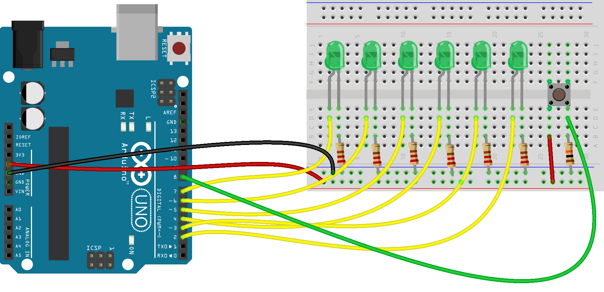
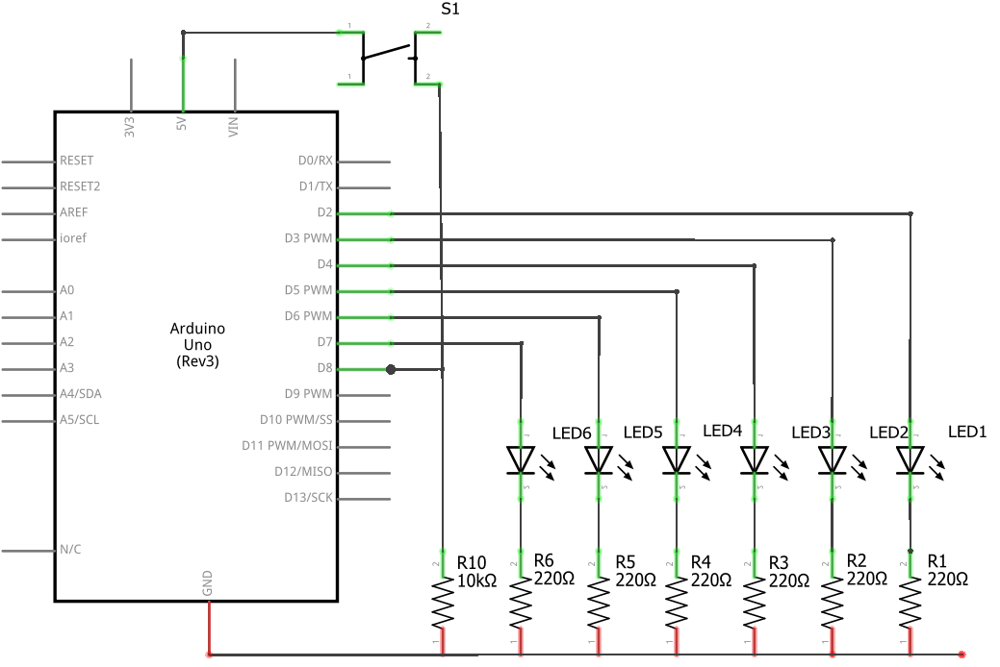

# Arduino Dice

A simple electronic dice built with an Arduino Uno.

## Important

Upload the `Dice.ino` sketch before connecting the breadboard.

Pin D8 is used as an input for the push button. The circuit uses an
external 10 kΩ pull-down resistor, so D8 should not be configured as
an output while this circuit is connected.

Press the button to start the dice animation. The LEDs animate before
the final dice result is displayed.

## Hardware

- Arduino Uno
- 6 × green LEDs
- 6 × 220 Ω resistors
- 1 × push button
- 1 × 10 kΩ resistor
- Breadboard

## Pin Configuration

| Arduino pin | Function |
|---|---|
| D2 | LED 1 |
| D3 | LED 2 |
| D4 | LED 3 |
| D5 | LED 4 |
| D6 | LED 5 |
| D7 | LED 6 |
| D8 | Push button |

## Wiring

### Breadboard

### Wiring diagram

